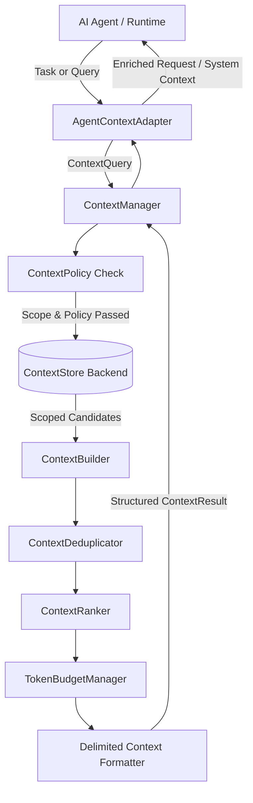

# Architecture: AsuX Context Engine V1

The **Context Engine** is the central information broker for AI agents in the AsuX AI platform. It decouples business data retrieval and assembly from the core execution loop and LLM prompt generation.

## Component Responsibilities

1. **ContextManager**: High-level facade providing an intuitive API for adding, updating, retrieving, clearing, and assembling context.
2. **ContextStore**: Pluggable storage abstraction. Default `InMemoryContextStore` provides thread-safe isolated storage.
3. **ContextPolicy**: Security layer enforcing allowed context types, item size caps, sensitivity ceilings, and mandatory tenant isolation.
4. **ContextRanker**: Multi-factor ranking engine evaluating keyword/token relevance, explicit priority weighting, and recency decay.
5. **ContextDeduplicator**: Conservative deduplication recognizing exact and normalized text duplicates while merging metadata.
6. **TokenBudgetManager**: Ensures assembled context respects maximum token budgets using a documented heuristic estimator.
7. **ContextBuilder**: Orchestrator assembling filtered, deduplicated, ranked, and bounded context with clear untrusted delimiters.
8. **Adapters**: Clean boundary adapters for Project 4 (`asux-agent-runtime`) and Project 1 (`asux-llm-gateway`).
